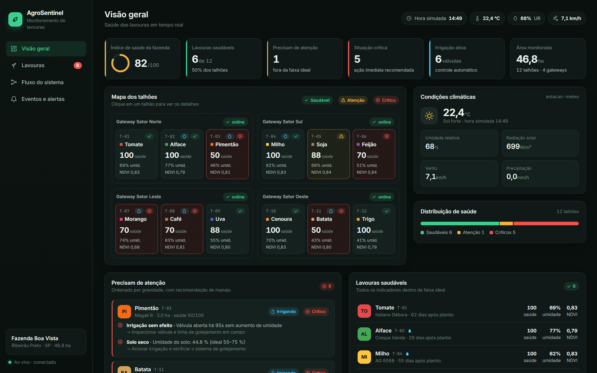
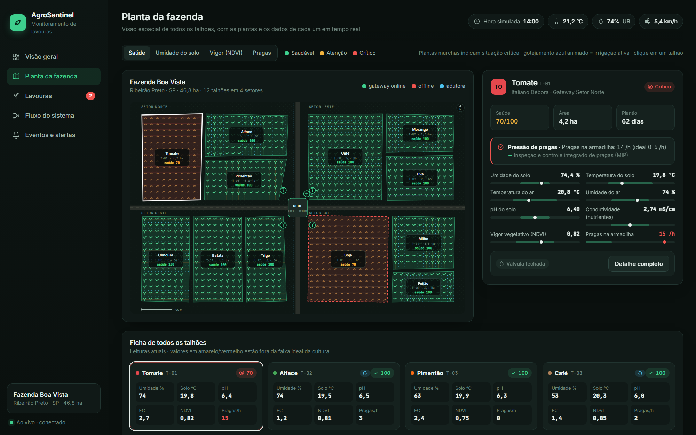

# AgroSentinel — Monitoramento de Lavouras com IoT

Sistema que monitora uma plantação talhão por talhão: mostra quais lavouras estão **saudáveis** e quais
**precisam de atenção**, explica o motivo, recomenda o manejo e aciona a **irrigação automaticamente**.
Um segundo painel acompanha o **fluxo de todo o sistema** em tempo real, do sensor até a tela.

Todos os componentes físicos (gateways de campo, estação meteorológica e atuador de irrigação) rodam
**simulados em containers Docker** e conversam por MQTT, exatamente como hardware real faria.



**Planta da fazenda:** planta baixa com os 12 talhões no lugar, plantas que murcham quando a lavoura
fica crítica, gotejamento animado quando a irrigação está ativa e camadas de saúde, umidade, NDVI e pragas.



## Início rápido

```bash
docker compose up -d --build
```

- Painel: <http://localhost:8080>, com uma página por item da sidebar:

  | Página | Arquivo |
  |---|---|
  | Visão geral | `index.html` |
  | Planta da fazenda | `planta.html` |
  | Lavouras | `lavouras.html` |
  | Fluxo do sistema | `fluxo.html` |
  | Eventos e alertas | `eventos.html` |
- Broker MQTT no host: `localhost:1884` → `mosquitto_sub -h localhost -p 1884 -t "agro/#" -v`

## Arquitetura

```
 CAMPO (containers)            COMUNICAÇÃO        PROCESSAMENTO (agro-core)         APRESENTAÇÃO
 ┌──────────────────┐                             ┌────────────┐   ┌────────────┐
 │ node-norte/sul/  │──telemetria──┐              │  Ingestão  │──▶│  SQLite    │
 │ leste/oeste      │              ▼              └─────┬──────┘   └────────────┘
 ├──────────────────┤        ┌───────────┐              ▼          ┌────────────┐   ┌─────────┐
 │ estacao-meteo    │──────▶ │ Mosquitto │ ────▶  Motor de regras ─▶│ REST + WS  │──▶│ Painel  │
 ├──────────────────┤        └───────────┘              │          └────────────┘   │ (Nginx) │
 │ atuador-irrigacao│◀── comandos ───┘◀──── Automação ◀──┘                           └─────────┘
 └──────────────────┘
```

| Container | Papel |
|---|---|
| `agro-node-norte`, `-sul`, `-leste`, `-oeste` | Gateway de setor: 3 talhões cada, 8 sensores por talhão, publica a cada 2 s |
| `agro-estacao-meteo` | Temperatura, umidade, vento, radiação e chuva (1 dia simulado = 12 min) |
| `agro-atuador-irrigacao` | Recebe comandos e abre/fecha as válvulas de gotejamento |
| `agro-broker` | Eclipse Mosquitto (com estatísticas `$SYS`) |
| `agro-core` | Ingestão, motor de regras, automação, persistência SQLite, API REST + WebSocket |
| `agro-dashboard` | Nginx servindo o painel e fazendo proxy de `/api` e `/ws` |

### Tópicos MQTT

| Tópico | Origem → destino |
|---|---|
| `agro/telemetry/<nó>/<talhão>` | gateways → core |
| `agro/weather` | estação → gateways, core |
| `agro/status/<dispositivo>` | heartbeat + Last Will (`online:false`) |
| `agro/cmd/irrigation/<talhão>` | core → atuador |
| `agro/actuator/irrigation/<talhão>` | atuador → gateways, core (estado retido) |

## Como o sistema decide

Cada cultura tem uma faixa ideal por indicador em [`config/farm.json`](config/farm.json)
(umidade e temperatura do solo, temperatura e umidade do ar, pH, condutividade, NDVI e pragas).

- **Saudável**: todos os indicadores na faixa ideal (nota 100)
- **Atenção**: fora da faixa, mas dentro da tolerância (−12 por indicador)
- **Crítico**: além da tolerância, irrigação sem efeito ou sensor sem comunicação (−30)

Leituras são suavizadas por média móvel e o status só muda após 3 avaliações seguidas.

**Irrigação automática:** abre abaixo do mínimo da cultura e fecha ao atingir 70% da faixa ideal.
Se a válvula fica aberta 90 s sem a umidade subir, gera alerta crítico de falha. O operador pode
abrir/fechar pelo painel (a automação pausa 60 s).

Os simuladores injetam anomalias aleatórias (falha de válvula, surto de pragas, acidificação,
deficiência nutricional) e alguns problemas iniciais (`SEED_ANOMALIES` no compose) para a
demonstração. A frequência é ajustável com `ANOMALY_RATE`.

## Teste de resiliência

```bash
docker stop agro-node-leste          # gateway cai: Last Will, alerta crítico, fluxograma em vermelho
docker stop agro-atuador-irrigacao   # comandos sem confirmação em 10 s viram alerta
docker compose start                 # tudo se recupera sozinho
```

## Estrutura

```
agro-monitor/
├── config/farm.json          # fazenda, culturas, faixas ideais e talhões (fonte única)
├── mosquitto/                # configuração do broker
├── simulators/               # dispositivos físicos simulados (Python + paho-mqtt)
├── backend/                  # serviço central (Node.js 22, Express, mqtt.js, ws, node:sqlite)
├── dashboard/public/         # painel web (HTML/CSS/JS sem build, servido por Nginx)
│   ├── index.html, planta.html, lavouras.html, fluxo.html, eventos.html
│   └── js/common.js + js/pages/<página>.js
└── docs/
    ├── apresentacao/         # fontes dos slides
    └── screenshots/
```
